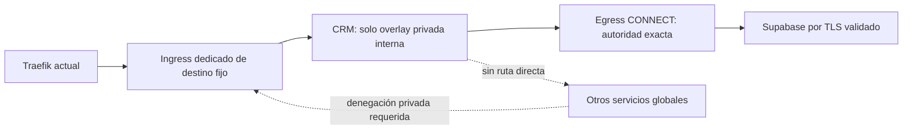

# Unidad50 — laboratorio ejecutable de aislamiento · 23/10/2026

**Propuesta, no despliegue ni autorización.** CLAIM50 #67/6370417419. Base técnica187/68a08a69 (Next16.4.3); no se adopta como candidata comercial.186/1b256761 y175/f9aa intactas.

## Hallazgo y limitación

La App crm-telecom-staging existe y sigue en init/source, sin contenedor. La sesión administrativa HTTPS se ha comprobado autenticada; no se vuelve a pedir acceso. Sigue faltando un dominio con autorización concreta.

La lectura anterior del VPS confirmó que el CRM antiguo está conectado tanto a la overlay global easypanel como a la de proyecto. La global incluye n8n/runners/proxy. Un puerto sin publicación externa no impide comunicación lateral dentro de esa red.

La [documentación oficial de App](https://easypanel.io/docs/services/app) describe puertos, réplicas, capacidades y sysctls, pero no un override de redes por App. La ficha sin fuente no permite comprobar ajustes posteriores en UI. No se afirma que la API admita un campo no documentado ni se modifica configuración global para averiguarlo.

[Docker](https://docs.docker.com/engine/network/drivers/overlay/) admite servicios en distintas overlays. Esa separación no prueba por sí sola las restricciones de salida o el comportamiento del proxy; por eso se añade un ensayo real, independiente de los servicios alojados.

## Topología mínima a revisar

Ingress comparte la red global y la privada, pero solo puede reenviar al CRM; no es un proxy genérico. Egress comparte privada y una red de salida exclusiva, sin pertenecer a la global. El CRM permanece únicamente en privada/internal, sin puertos publicados, privilegios o socket Docker.

La ruta nueva de Traefik podría usar el destino personalizado del dominio para alcanzar ingress. Esto evita proponer una conexión directa del CRM a la red global. **No está configurado ni aceptado**: requiere demostrar soporte/persistencia en EasyPanel y revisar la privacidad del ingress.

Si EasyPanel vuelve a adjuntar global/proyecto en cada Deploy, no basta desconectarlas después de arrancar. La alternativa mínima a revisar es crear/actualizar exclusivamente la nueva App con réplicas0, aplicar redes propias antes del primer proceso, inspeccionar el spec exacto y solo entonces activar1réplica. Hace falta un mecanismo soportado de reconciliación y rollback; no se ejecuta ese cambio de control plane ni se entrega un script de mutación del VPS.

No se propone cambiar redes ajenas o reiniciar Traefik. Los dos relays son componentes requeridos por esta alternativa, sujetos a aprobación W4/W5, presupuesto de recursos y sus propios escaneos. Otra decisión posible es control de egress por namespace del nuevo servicio; también necesita revisión, sin cambios globales unilaterales.

## Ensayo y código

- network-policy.mjs: guards de runner/daemon, autoridad CONNECT cerrada y propiedad para teardown.
- network-fixture.mjs: fixtures sintéticos de backend, víctima, edge, ingress fijo, egress y upstream TLS; no es una segunda implementación del CRM.
- network-acceptance.mjs: Swarm/overlays reales solo sobre daemon inicialmente vacío e inactivo en runner GitHub-hosted Linux. Refusa VPS Swarm activo, contenedores preexistentes, STAGING/PROD, runners compartidos/self-hosted y credenciales alojadas.
- crm-network-isolation.yml: workflow propio, contentsread, sin secrets/registry/deploy y sin cancelar trabajos en curso.

Se reproduce primero la exposición causal: al adjuntar el backend fixture a la overlay compartida sí llega a la víctima. Después se desconecta solo ese fixture propio y se comprueban DNS/IP lateral denegados, acceso al proxy global denegado y ausencia de bypass directo al upstream.

Positivos: ingress con admisión sintética hacia destino fijo y TLS por CONNECT a autoridad exacta. Negativos: ingress sin admisión, otro hostname, otro puerto y certificado con hostname erróneo. Se inspeccionan red única del backend, nonroot, readonly, capdropALL, no-new-privileges y ausencia de port bindings.

Los6contenedores usan la imagen oficial Node24 por digest ya fijada en el Dockerfile existente,96MB/0,25CPU/pids64 por fixture. Ningún socket Docker se monta. Solo el host del runner usa Docker. La clave/certificado son efímeros de laboratorio, separados por montajes y nunca publicados. El teardown exige IDcapturado+label aleatoria de este run antes de borrar; cierra únicamente el Swarm inicializado por el ensayo cuando no hay servicios inesperados.

## Límites de la prueba

El certificado y upstream son sintéticos; **no se contacta Supabase real**. El frontend es fixture, **no una aceptación de Traefik real**. El puertoTLS8443 es de laboratorio; producción usaría la autoridad exacta Supabase443. No hay HTTP_PROXY/NODE_USE_ENV_PROXY nuevo vinculado a la app real.

El ensayo **no demuestra prevención de exfiltración DNS**, ausencia de rebinding, ACL de proveedores ni seguridad completa de un ingress/egress de producción. Falta una implementación endurecida que limite resolución/destinos privados, conexiones, recursos y autenticación; estos son blockers explícitos, no excepciones. Tampoco demuestra persistencia del aislamiento ante Deploy/Restart/rollback de EasyPanel.

## Validación y decisión

Local:4tests PASS, positivos/negativos con transporte CONNECT real y ausencia de dial al denegar; sintaxis PASS. La invocación del lab en Windows se rechaza antes de Docker (GITHUB_HOSTED_LINUX_LAB_ONLY), teardownPASS/0recursos. Resultado de Swarm real **pendiente de CI** al publicar. No se afirma aislamiento alojado.

REQUEST W4/W5: revisar topología, riesgo de relays/DNS y mecanismo per-service con réplicas0; decidir implementación y autorización de control plane antes de arrancar el CRM. Mientras tanto el bloqueo STAGING/SMTP se trabaja en otra propuesta cerrada por defecto.

Rollback actual: solo código de propuesta. No redes/servicios del VPS creados, desconectados o modificados. App vacía conservada;0EUR/IAOFF/Storage88NO/RELEASE_NOT_ACCEPTED.
