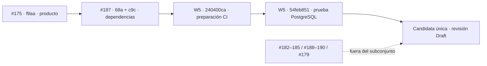

# Unidad 56 · composición comercial controlada · 26/10/2026

La candidata conserva el producto de #175 y compone las correcciones de Next/Zod de #187, la preparación de CI de W5 y su prueba nativa de concurrencia de onboarding. **No cambia los archivos de producto `src/` ni ninguna de las 87 migraciones de #175.** La integración se publica en una rama nueva y una PR Draft para revisión independiente; no es una adopción alojada ni una release.

La auditoría fresca del lock de #175 detecta **1 CRITICAL en Next y 1 HIGH en Zod**. La del lock compuesto devuelve **0 vulnerabilidades**. Los cinco HIGH históricos pertenecen a sus fechas y fuentes; no se reutilizan como resultado actual.

## Fuente, propiedad y procedencia

- Base de producto: `f9aa469bec768ad73572a2f462f1f1505e6791a5`, #175. Es la candidata comercial mejor acreditada en su alcance funcional; no se sustituye por la rama predeterminada de seguridad.
- Dependencias: `68a08a692950a12ab18b3abf8d331cbc8f94fc64` y `c9c5ecd22ee80e1461bf29f3b560bbb97e386953`, #187. Se hereda su historia completa sobre #175, sin importar otras propuestas.
- Preparación Supabase CI: original W5 `240400ca20fc9960490ec686855698263eb60f6c` → selección con `-x` `b04663a446d1f35f50415025ed92cfd3dd3b2df8`. Únicamente workflow y test de preparación.
- Concurrencia PostgreSQL: original W5 `54feb851ab2f9e8f08a80395d0b7ba5269bb31cb` → selección con `-x` `ef0851f176f00acfc6b0d4864262cd936fee105c`. Únicamente test nativo y llamada desde el arnés existente.
- Checkpoint de código previo a esta documentación: `ef0851f176f00acfc6b0d4864262cd936fee105c`, árbol `9b45c151305a5a0c94eeddcf961c9ae606649417`. El SHA y árbol publicados tras documentar se registran en la PR y #67; no se deducen de este checkpoint.

[Mapa completo de las once PR, bases, merge bases, diferencias, contratos, migraciones, propietarios y CI](evidence/UNIT_56_PROVENANCE_20261026.json). El mapa distingue la base que devuelve la API de la punta actual de la rama base. En #188/#189 la rama de dependencias ya avanzó desde 68a a c9c; #179 también se ha separado de la punta actual de #175. No se atribuyen a un HEAD nuevo los resultados de uno anterior.

La selección de los dos deltas W5 está pedida por su autor en [#171](https://github.com/Asier-Comba/CRM-Telecomunicaciones/pull/171#issuecomment-6346583342) y [#67](https://github.com/Asier-Comba/CRM-Telecomunicaciones/issues/67#issuecomment-6404302286). Los cuatro blobs seleccionados se han comparado y son idénticos a sus originales. El [CLAIM 56](https://github.com/Asier-Comba/CRM-Telecomunicaciones/issues/67#issuecomment-6412584478) acota el trabajo a composición, dependencias, CI y ensayos. W2 mantiene la propiedad del frontend; no se editan sus componentes ni bancos.

## Qué se consume y qué queda pendiente

| Cambio | Decisión y revisión necesaria |
|---|---|
| #175 | Base funcional seleccionada; sin aceptación comercial o de seguridad global |
| #187 | Compuesta como propuesta de corrección; W4/W5 siguen pendientes antes de adopción alojada |
| #171 | Solo `240400ca`; no importar rama, políticas de excepciones ni contrato OpenAI |
| W5 `54feb851` | Prueba nativa seleccionada por petición del autor; resultados de la nueva composición deben ejecutarse por separado |
| #182 | Auditoría separada fuera del primer subconjunto; la auditoría existente sigue obligatoria y devuelve cero |
| #183/#184 | Fuera: decisión W1 sobre recibo/errores y coordinación W2; revisión W4 pendiente |
| #185 | Fuera: adopción de la experiencia de informes pendiente de coordinación W2 |
| #188 | Fuera: un laboratorio no acepta la red del VPS |
| #189/#190 | Fuera: contratos de arranque y build/runtime sin aceptación STAGING |
| #179 / Storage 88 | Fuera por prohibición expresa; ninguna migración nueva ni cambio de bytes privados |

## Reproducción y pruebas propias

1. **Dependencias:** dos locks exactos, consultados con la auditoría actual. #175: 1 CRITICAL + 1 HIGH; compuesto: 0. Next/eslint-config-next 16.4.3 y Zod de herramientas 4.6.7. El paquete, lock y SBOM proceden de #187; React y los contratos del producto no cambian.
2. **Preparación de CI:** el test de W5 sobre el workflow exacto c9c da 2 PASS / 1 FAIL por ausencia de los pasos de caché. Después de seleccionar el delta, 3/3 PASS. Se conserva el límite del job en 35 minutos, el comando de aceptación, `W2_PRODUCT_UI=true` y la retención de evidencias; la preparación se limita a 6 minutos. El primer uso con un lock nuevo puede tener caché fría; no se promete que elimine toda incidencia de infraestructura.
3. **Plataforma:** 109 PASS / 0 FAIL / 1 SKIP en esta composición. El SKIP es el recurso Docker real, indisponible localmente, y no se cuenta como aceptación nativa.
4. **Calidad local:** instalación por lock, lint global, compilación de 44 rutas y tipos posteriores al build PASS. El build usa configuración pública no habilitada; no acredita bindings alojados.
5. **PostgreSQL:** sintaxis del nuevo ensayo PASS. El motor Docker local no está disponible. La CI de esta composición debe dar su propio resultado nativo y Supabase real desechable; nunca se sustituyen por PGlite o fixtures de preview.

El run W5 `40240003086`, `workflow_dispatch` de `54feb851`, tiene job nativo `121309573236` SUCCESS y teardown PASS. Su global es FAILURE por calidad y secret scan; las coincidencias del scan corresponden a historia y archivos ajenos al nuevo test, y no se silencian. La aceptación de 87/4042/116 de fuentes anteriores sigue siendo histórica, no de esta composición. Cada resultado remoto nuevo se publicará con su SHA, árbol, run, intento y alcance.

## Alojamiento, presentación y rollback

La vía de menor dependencia para una futura aceptación es el Netlify privado existente: conserva el origen canónico y la integración Auth ya configurada. Antes de publicar otra fuente necesita revisión W4/W5, gates exactos, build reproducible con adaptador efectivo fijado, configuración pública compilada, ventana autorizada y artefacto/deploy trazable. Un `next build` local no cumple esos requisitos.

EasyPanel mantiene pendientes el aislamiento del VPS, la aceptación STAGING de arranque, la correspondencia build/runtime, el origen admitido y una imagen por digest de manifiesto verificable. Un configID o un contenedor que arranca no suplen esos gates. No se configura ni despliega nada por esta composición.

La presentación queda protegida: Netlify, su despliegue existente, la demo local c9c, los datos de staging y el paquete de respaldo permanecen intactos. El recorrido alojado continúa **NOT_RUN/BLOCKED** mientras no haya una sesión sintética autorizada disponible para su aceptación. La recuperación de credenciales preparada en privado no se ejecuta durante esta fase.

Rollback futuro: conservar los bytes, configuración y deploy ID del artefacto estable antes de cualquier operación autorizada. No reconstruir un SHA con adaptador mutable y llamarlo el mismo artefacto. La selección local es reversible mediante Git en esta rama; no requiere revertir datos, migraciones o servicios alojados. La documentación no ejecuta un rollback.

## Privacidad y estados

La consulta GitHub LIVE confirma **repositorio PUBLIC** y rama predeterminada `w4/security-baseline`. La visibilidad se comunica como riesgo al propietario y no se cambia. Se publican fuentes, contratos y evidencias sintéticas; no claves, `.env`, datos de cuentas, tokens ni enlaces privados de recuperación.

**IMPLEMENTADO / TESTED_LOCAL:** composición y controles anteriores. **TESTED_NATIVE / TESTED_BROWSER:** pendientes de CI propia y revisión de sus evidencias. **TESTED_HOSTED / W4_ACCEPTED:** no concedidos. **BLOCKED:** adopción alojada, controles de plataforma/historial/vendor, contratos excluidos y aprobación independiente. IA en vivo y escrituras siguen OFF; Storage 88 sin aplicar; presupuesto adicional 0 €.

Siguiente unidad: resolver el primer fallo causal de la CI propia sin ampliar contratos ni relajar gates, y después completar el recorrido con Auth real en el recurso desechable de esa misma fuente. Las mejoras de UX de W2 solo se seleccionan con su coordinación y una reproducción concreta.
